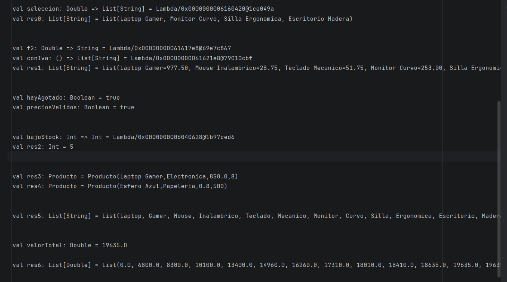
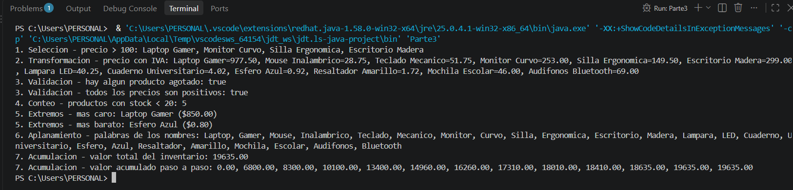
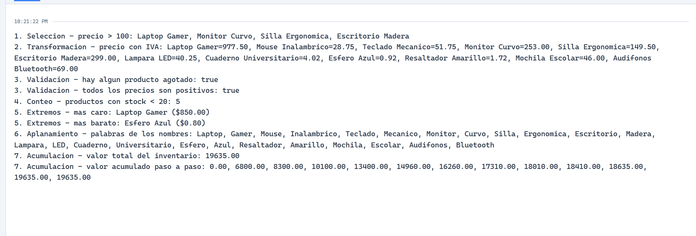
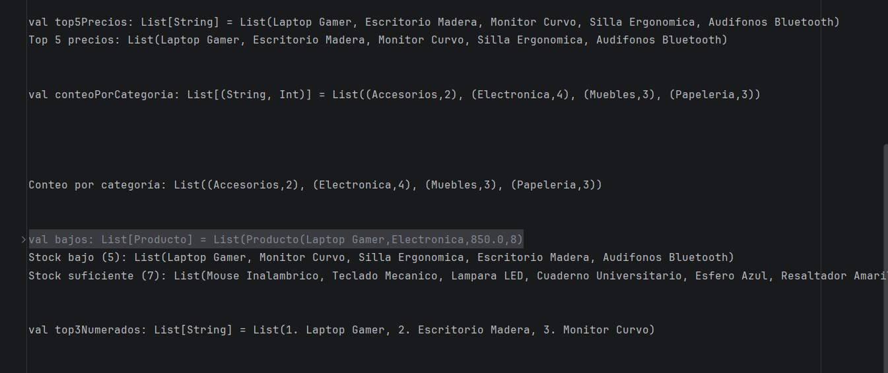

# Trabajo de Consulta: Funciones Anónimas 

**Estudiante:** Adrián Guamán
**Materia:** Programación Funcional  
**Lenguajes:** Scala, Java, Python  

---

## Objetivos de aprendizaje

* Reconocer donde se usa la programacion funcional en sistemas reales.
* Explicar que es una funci´on an´onima y por qu´e es la pieza clave de las operaciones con listas.
* Identificar los tipos de problemas que se resuelven con funciones anonimas.
* Investigar nuevas operaciones sobre colecciones y aplicarlas en la solucion de problemas.
* Comparar como Scala, Java y Python implementan las funciones anonimas y argumentar, con evidencia de tu propio codigo, por que son importantes.

## 📋 Tabla de Contenidos
1. [Parte 1: Exploración - La programación funcional en el mundo real](#parte-1-exploración---la-programación-funcional-en-el-mundo-real)
2. [Parte 2: Entender - ¿Qué es una función anónima?](#parte-2-entender---qué-es-una-función-anónima)
3. [Parte 3: Aplicar - Tipos de problemas con funciones anónimas](#parte-3-aplicar---tipos-de-problemas-con-funciones-anónimas)
4. [Parte 4: Ampliar - Cuatro operaciones nuevas y combinación](#parte-4-ampliar---cuatro-operaciones-nuevas-y-combinación)
5. [Parte 5: Comparar y Concluir](#parte-5-comparar-y-concluir)

---

## Parte 1: Exploración - La programación funcional en el mundo real

Investigación de casos de uso reales de la programación funcional y funciones anónimas en la industria.

### Caso 1: Apache Spark (Scala)
* **Problema que resuelve:** procesamiento distribuido de grandes volúmenes de datos (Big Data) en un clúster, tolerante a fallos.
* **Lenguaje / Herramienta:** Scala / Apache Spark.
* **Ventaja del enfoque funcional:** las transformaciones (`map`, `filter`) reciben funciones anónimas y no modifican los datos originales; Spark puede repartir esas funciones entre los nodos y ejecutarlas en paralelo sin efectos secundarios.
* **Fuente:** Abbasi, M. A. (2017). *Learning Apache Spark 2*, cap. 2 "Transformations and Actions with Spark RDDs", Packt. Y la guía oficial: https://spark.apache.org/docs/latest/rdd-programming-guide.html
* **Fragmento de código:**

  ```scala
  val lineas  = sc.textFile("logs.txt")
  val errores = lineas.filter(linea => linea.contains("ERROR"))
  ```
  `linea => linea.contains("ERROR")` es la función anónima: Spark la aplica a cada línea del archivo, en paralelo, y se queda solo con las que contienen "ERROR".

### Caso 2: Java Streams en sistemas empresariales (Java)
* **Problema que resuelve:** procesar colecciones de datos (usuarios, pedidos, transacciones) de forma declarativa en aplicaciones corporativas.
* **Lenguaje / Herramienta:** Java 8+ (Streams API y expresiones lambda).
* **Ventaja del enfoque funcional:** se describe *qué* se quiere (filtrar, transformar) y no *cómo* recorrer la lista; el mismo código puede ejecutarse en paralelo cambiando `.stream()` por `.parallelStream()`.
* **Fuente:** Oracle, documentación de `java.util.stream`: https://docs.oracle.com/javase/8/docs/api/java/util/stream/package-summary.html
* **Fragmento de código:**

  ```java
  List<String> correosActivos = usuarios.stream()
      .filter(u -> u.isActivo())
      .map(u -> u.getCorreo())
      .collect(Collectors.toList());
  ```
  La primera lambda deja pasar solo a los usuarios activos; la segunda convierte cada usuario en su correo.


## Parte 2: Entender - ¿Qué es una función anónima?

### ¿Qué es una función anónima y de dónde viene el nombre lambda?

Una función anónima es una definición de función que no está vinculada a un identificador (nombre) explícito en el ámbito en el que se declara. El término lambda proviene del cálculo lambda, un sistema formal desarrollado en la década de 1930 por el matemático Alonzo Church para investigar la definición de funciones, la aplicación de funciones y la recursión.

La misma idea de "función sin nombre" en los tres lenguajes:

```python
lambda x: x * x      # Python
```
```scala
x => x * x           // Scala
```
```java
x -> x * x           // Java
```

### ¿En qué se diferencia de una función nombrada? Escribe la misma lógica de ambas formas.

Función nombrada: Posee un identificador que permite invocarla múltiples veces desde cualquier parte de su ámbito.

Función anónima: Es una expresión compacta, generalmente utilizada de forma efímera (como argumento para otra función).

Ejemplo en Python:

  ```python
  # Función nombrada
  def cuadrado(x):
      return x * x
  print(list(map(cuadrado, [1, 2, 3])))          # [1, 4, 9]
  
  # Función anónima: la misma lógica, sin nombre, pasada directo a map
  print(list(map(lambda x: x * x, [1, 2, 3])))   # [1, 4, 9]
  ```

### ¿Qué significa que las funciones sean ciudadanos de primera clase? ¿Por que eso permite pasar una lambda a map o filter?

Significa que las funciones son tratadas como cualquier otro valor o variable del lenguaje: pueden asignarse a variables, almacenarse en estructuras de datos, pasarse como argumentos a otras funciones y retornarse desde ellas. Esto es exactamente lo que permite inyectar una lambda directamente en métodos como map o filter.

```python
# Función nombrada
def cuadrado(x):
    return x * x
print(list(map(cuadrado, [1, 2, 3])))          # [1, 4, 9]

# Función anónima: la misma lógica, sin nombre, pasada directo a map
print(list(map(lambda x: x * x, [1, 2, 3])))   # [1, 4, 9]
```

### ¿Qué es un closure? Muestra una lambda que use una variable definida fuera de ella.

Un closure es una función que recuerda y puede acceder a las variables de su ámbito léxico exterior, incluso cuando la función es ejecutada fuera de ese ámbito original.

Ejemplo en Scala:

  ```Scala
  val umbralPrecio = 50.0 // Variable externa
  // La lambda captura 'umbralPrecio' desde fuera de su cuerpo
  val esCaro = (precio: Double) => precio > umbralPrecio
  println(List(30.0, 80.0).filter(esCaro))  // List(80.0)
  ```

## Parte 3 - Aplicar: ¿en qué problemas sirven las funciones anónimas?

Todos los ejemplos usan la misma lista de 12 productos (`nombre, categoria, precio, stock`).
Código completo: [Scala](scala/Parte3.scala) · [Java](java/Parte3.java) · [Python](python/parte3.py)

| Tipo | Situación real | Scala | Java (Streams) | Python |
|---|---|---|---|---|
| Selección | Una tienda quiere mostrar una sección de productos "premium" (precio > $100) | `filter(p => p.precio > 100)` | `.filter(p -> p.precio() > 100)` | `filter(lambda p: p.precio > 100, productos)` |
| Transformación | La tienda debe mostrar el precio final con IVA del 15 % | `map(p => p.precio * 1.15)` | `.map(p -> p.precio() * 1.15)` | `map(lambda p: p.precio * 1.15, productos)` |
| Validación | Bodega verifica si hay algún producto agotado y si todos los precios son válidos antes de publicar el catálogo | `exists(p => p.stock == 0)` / `forall(p => p.precio > 0)` | `.anyMatch(p -> p.stock() == 0)` / `.allMatch(...)` | `any(map(lambda p: p.stock == 0, productos))` / `all(...)` |
| Conteo | El reporte de reposición necesita saber cuántos productos tienen stock bajo (< 20) | `count(p => p.stock < 20)` | `.filter(p -> p.stock() < 20).count()` | `len(list(filter(lambda p: p.stock < 20, productos)))` |
| Extremos | Gerencia pide el producto más caro y el más barato | `maxBy(p => p.precio)` / `minBy(...)` | `.max(Comparator.comparingDouble(p -> p.precio()))` | `max(productos, key=lambda p: p.precio)` |
| Aplanamiento | Un buscador necesita todas las palabras de los nombres en una sola lista | `flatMap(p => p.nombre.split(" ").toList)` | `.flatMap(p -> Arrays.stream(p.nombre().split(" ")))` | `chain.from_iterable(map(lambda p: p.nombre.split(" "), productos))` |
| Acumulación | Contabilidad quiere el valor total del inventario y cómo crece producto a producto | `foldLeft(0.0)((acc, p) => acc + p.precio * p.stock)` / `scanLeft` | `.reduce(0.0, (acc, p) -> acc + p.precio() * p.stock(), Double::sum)` (sin `scanLeft`: ciclo) | `reduce(lambda acc, p: acc + p.precio * p.stock, productos, 0.0)` / `accumulate` |

**Salida (idéntica en los tres lenguajes):**





## Parte 4 - Ampliar: Cuatro operaciones nuevas y combinación

Código completo: [operaciones/Parte4.scala](operaciones/Parte4.scala)

### 4.1 y 4.2 Fichas

| | `sortBy` | `groupBy` | `partition` | `zipWithIndex` |
|---|---|---|---|---|
| **Qué hace** | Ordena la lista según un criterio | Reparte los elementos en grupos según una clave | Divide la lista en dos: los que cumplen y los que no | Pega a cada elemento su posición (0, 1, 2...) |
| **Lambda que recibe** | Recibe un elemento y devuelve el criterio de orden (un `Double`, `String`...) | Recibe un elemento y devuelve la clave del grupo | Recibe un elemento y devuelve `Boolean` | No recibe lambda; se encadena con `map` que usa `case (p, i) => ...` |
| **Ejemplo (Scala)** | `productos.sortBy(p => -p.precio).take(5)` | `productos.groupBy(p => p.categoria)` | `productos.partition(p => p.stock < 20)` | `lista.zipWithIndex.map { case (p, i) => s"${i + 1}. ${p.nombre}" }` |
| **Problema real** | Ranking de los 5 productos más caros para el catálogo. Se parece a **Extremos** (generaliza maxBy a "los N mejores") | Reporte de cuántos productos hay por categoría. **Tipo nuevo: agrupación** | Separar productos que hay que reponer de los que no. Se parece a **Selección**, pero conserva ambos lados | Numerar un podio o ranking. **Tipo nuevo: enumeración** |

(La salida de cada ficha está en la captura de la Parte 4.)

### 4.3 Combinar operaciones
**Pregunta:** ¿Qué categorías tienen más de 100 unidades en stock, ordenadas de mayor a menor?

```scala
productos
  .groupBy(p => p.categoria)                          // nueva
  .filter { case (_, ps) => stockTotal(ps) > 100 }    // vista en clase
  .toList
  .sortBy { case (_, ps) => -stockTotal(ps) }         // nueva
```
1. `groupBy`: agrupa los productos por categoría → `Map[categoria, List[Producto]]`.
2. `filter`: se queda con las categorías cuya suma de stock supera 100 (`stockTotal` suma el stock con `foldLeft`).
3. `toList` + `sortBy`: convierte el `Map` en lista y la ordena por stock total, de mayor a menor.

Resultado: Papelería (850) y Electrónica (123).



 ## Parte 5: Comparar y concluir

### 5.1 Scala, Java y Python frente a frente

| Criterio | Scala | Java | Python |
|---|---|---|---|
| Sintaxis de la lambda | `p => p.precio > 100` | `p -> p.precio() > 100` | `lambda p: p.precio > 100` |
| Cómo se declara el tipo | Se infiere del contexto; se puede escribir `(p: Producto) => ...` | Se infiere de la interfaz funcional esperada (`Predicate`, `Function`...) | No se declara (tipado dinámico) |
| Operaciones con listas disponibles | Todas directas sobre `List`: `filter`, `map`, `exists`, `forall`, `count`, `maxBy`, `flatMap`, `foldLeft`, `scanLeft` | Vía `Stream`: `filter`, `map`, `anyMatch`, `allMatch`, `count`, `max`/`min`, `flatMap`, `reduce`. **No hay `scanLeft`** | `filter`, `map`, `any`/`all`, `max`/`min` con `key`, `reduce`, `accumulate`. **No hay `flatMap` ni `count` directos** (se usa `chain.from_iterable` y `len`) |
| Restricción del lenguaje | Pocas; las tuplas necesitan `case (a, b) =>` | La lambda solo existe donde hay una interfaz funcional; hay que abrir `.stream()` y cerrar con `collect`/`toList`; variables capturadas deben ser *effectively final* | La lambda admite solo **una expresión** (sin sentencias); `filter` y `map` devuelven iteradores y hay que envolverlos en `list()` |
| Legibilidad (mi opinión) | Alta: es la más corta y se lee de izquierda a derecha | Media: más larga por `.stream()`, `.collect(...)` y los `()` de los records | Media: clara en casos simples, pero `map(lambda..., filter(lambda..., x))` se lee de adentro hacia afuera |

**¿En qué lenguaje fue más natural?** En Scala: las operaciones viven directamente en la lista y se encadenan sin pasos intermedios.

**¿Dónde hubo más diferencias?** En **Acumulación** y **Aplanamiento**. Java no tiene `scanLeft`, así que tuve que usar un ciclo; Python no tiene `flatMap`, así que tuve que combinar `chain.from_iterable` con `map`. En Selección, Transformación y Conteo las tres versiones son casi iguales y solo cambia la sintaxis.

### 5.2 Conclusión

Las funciones anónimas son la pieza que hace útiles a `map`, `filter` o `foldLeft`: sin ellas habría que escribir y nombrar una función aparte para cada condición o transformación, o volver al ciclo `for` con variables que cambian. Con la lambda, la condición se escribe en el mismo lugar donde se usa (`p => p.stock < 20`) y la operación describe *qué* se quiere obtener, no *cómo* recorrer la lista. Esto lo comprobé con los tres lenguajes: los siete tipos de problemas se resolvieron con una línea o una cadena corta de operaciones, y las diferencias estuvieron en la sintaxis y en operaciones que faltan, no en la idea.

Esa misma idea es la que usa Apache Spark (Parte 1, Caso 1): `lineas.filter(linea => linea.contains("ERROR"))` es una función anónima que Spark puede repartir entre los nodos de un clúster y ejecutar en paralelo. Como la función no depende de variables que cambian, el mismo código sirve para una lista de 12 productos o para millones de líneas de log.

## Referencias
- Abbasi, M. A. (2017). *Learning Apache Spark 2*. Packt Publishing.
- Apache Spark. RDD Programming Guide: https://spark.apache.org/docs/latest/rdd-programming-guide.html
- Oracle. Paquete `java.util.stream`: https://docs.oracle.com/javase/8/docs/api/java/util/stream/package-summary.html
- Documentación oficial de Scala: https://docs.scala-lang.org
- Programación funcional en Python: https://docs.python.org/3/howto/functional.html
- Herramientas de IA: Claude (Anthropic), usado como apoyo para estructurar el README y generar el código base de las Partes 3 y 4, que fue ejecutado y revisado por mí.
